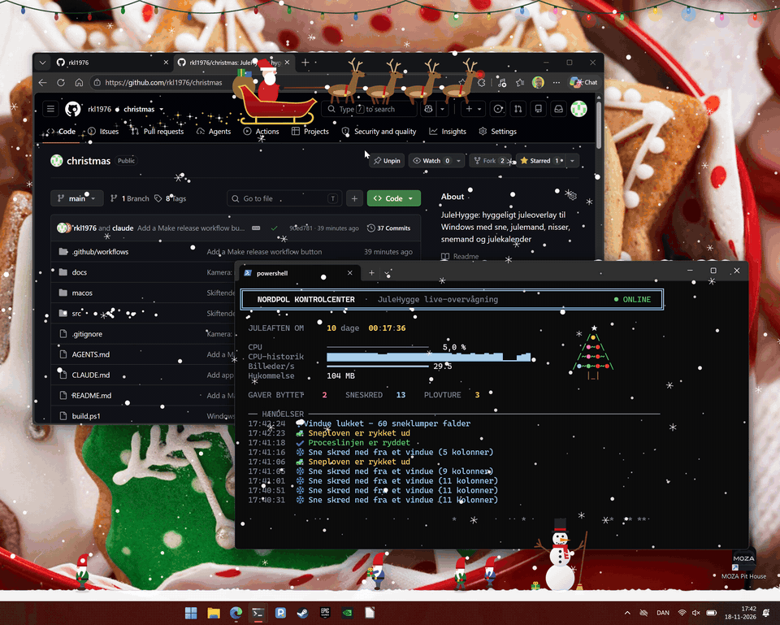
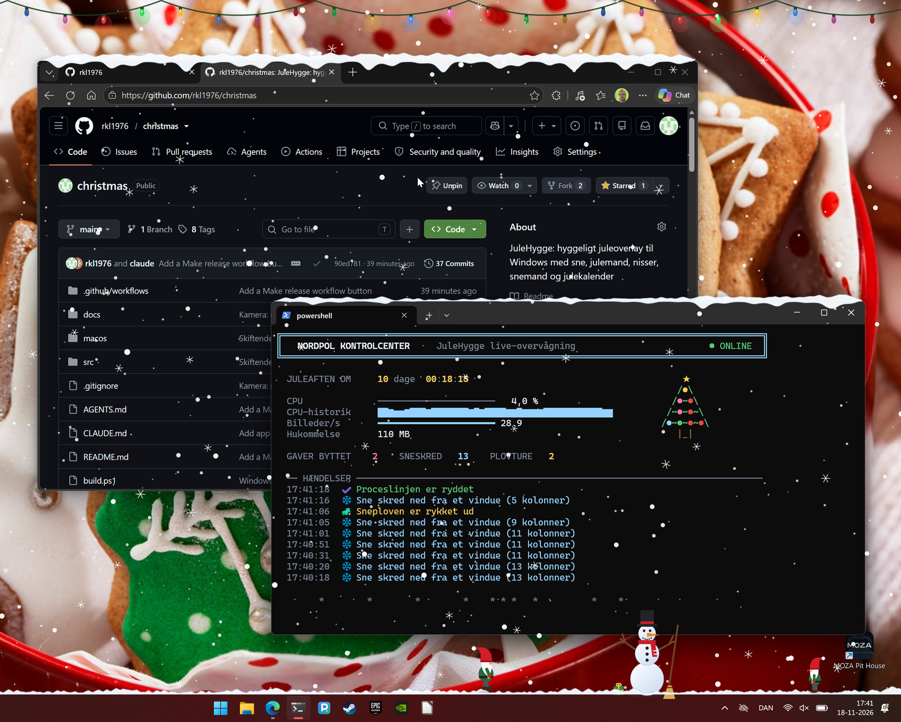
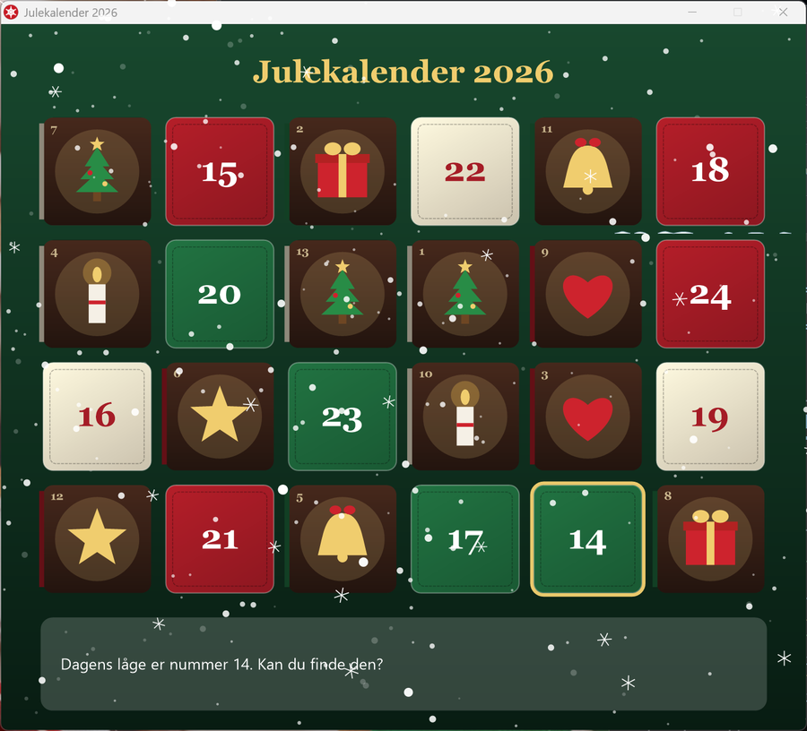

# JuleHygge 🎄

[Dansk](README.md) · [English](README.en.md) · [Svenska](README.sv.md) · [Deutsch](README.de.md) · [Nederlands](README.nl.md)

Ein kleines Weihnachts-Overlay für Windows, macOS und Linux: Schnee fällt über den Desktop und bleibt auf der Taskleiste und auf deinen Fenstern liegen, der Weihnachtsmann fliegt im Schlitten mit Rentieren (und Rudolph) vorbei, kleine Figuren laufen am unteren Bildschirmrand entlang und tauschen Geschenke, oben hängt eine Lichterkette, ein Schneemann wird jeden Tag ein Stück weitergebaut, und es gibt einen Adventskalender mit 24 Türchen.

| Schnee auf Fenstern, Figuren, Schneemann und Lichter | Adventskalender |
|---|---|
|  |  |

## Was es macht

- Das Overlay ist durchsichtig, und man klickt einfach hindurch. Es stört also nicht bei der Arbeit.
- Es funktioniert auf **allen Bildschirmen**. Der Weihnachtsmann fliegt über Bildschirme hinweg, die nebeneinander stehen.
- **Das Menü:** Ein Rechtsklick auf die Schneeflocke bei der Uhr (Windows und Linux) oder ein Klick auf sie in der Menüleiste (macOS) öffnet die Einstellungen und den Adventskalender. Dort lässt sich alles ein- und ausschalten.
- **Adventskalender:** Ab dem 1. Dezember kannst du jeden Tag ein neues Türchen öffnen. Dahinter stecken Witze, gemütliche Tipps und Wissenswertes rund um Weihnachten, und manche Türchen lösen einen Effekt aus: den Weihnachtsmann, einen Schneesturm, ein Fest oder einen Sternenregen.
- **Schneemann:** wird über 12 Tage gebaut, gerechnet ab dem ersten Start der App.
- **Schneepflug:** fährt los und räumt den Schnee, wenn der Haufen hoch wird.
- **Ton** ist aus, bis du ihn im Menü einschaltest: Schellen und eine Melodie für den Weihnachtsmann, Motor und Hupe für den Schneepflug.
- **Herbst-Thema:** Das Menü „Thema“ tauscht den Schnee gegen fallendes Laub, den Weihnachtsmann gegen Zuggänse und den Schneemann gegen eine Vogelscheuche.
- Die Animation pausiert von selbst, solange eine App im Vollbild läuft (Spiele, Filme), und hält ganz an, wenn der Bildschirm gesperrt ist oder ruht.
- Eine veröffentlichte Version hält sich selbst aktuell.

## Deine Sprache, deine Figuren

- **Sprache:** Das Menü erscheint in der Sprache deines Computers, wenn es dafür eine Übersetzung gibt (Dänisch, Englisch, Schwedisch, Deutsch, Niederländisch, Italienisch, Spanisch), sonst auf Englisch. Unter *Sprache* im Menü kannst du eine andere wählen.
- **Wer über deinen Bildschirm läuft**, richtet sich nach Sprache und Land: Nisser in den nordischen Ländern, Wichtel in Deutschland, Österreich und der Schweiz, Kabouter in den Niederlanden, Päkapikud in Estland und Weihnachtselfen überall sonst. Unter *Wichtel oder Elfen* im Menü kannst du andere wählen.
- Bisher nur auf Dänisch: der Adventskalender mit seinen Türchen und die Mitteilungen.

## Herunterladen

Lade die neueste Version von der [Release-Seite](https://github.com/rkl1976/christmas/releases/latest) herunter.

| System | Datei | So geht es |
|---|---|---|
| Windows | `JuleHygge.exe` | Einfach starten. Es muss nichts installiert werden. |
| macOS | `JuleHygge-macOS.zip` | Entpacken und JuleHygge in den Ordner „Programme“ verschieben. Die App ist nicht von Apple notarisiert, daher fragt macOS beim ersten Start möglicherweise nach deiner Erlaubnis. |
| Linux (Ubuntu, Linux Mint) | `JuleHygge-linux-x86_64.tar.gz` | Entpacken und `./install.sh` ausführen (ohne Root-Rechte). |

Beenden über das Menü: *Beenden*.

## Mehr

Wie die App gebaut wird, die Testhilfen und der Aufbau des Codes stehen in der [dänischen README](README.md) (teilweise auf Englisch), in [macos/README.md](macos/README.md) (Dänisch) und in [linux/README.md](linux/README.md) (Englisch). Wer eine Sprache hinzufügen möchte, findet die Anleitung in [assets/sprog/README.md](assets/sprog/README.md) (Englisch).

*Diese Seite wurde von einem Sprachmodell übersetzt und nicht von einer Person mit Deutsch als Muttersprache gelesen.*
