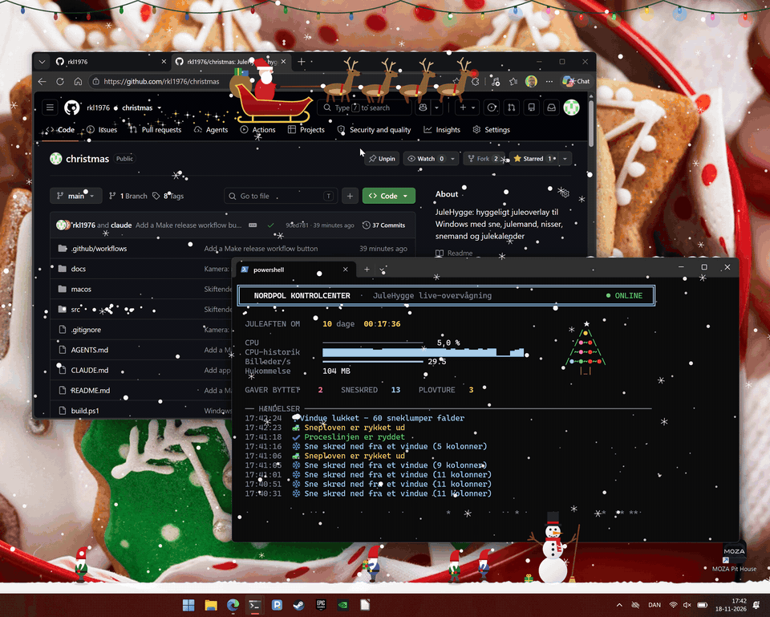
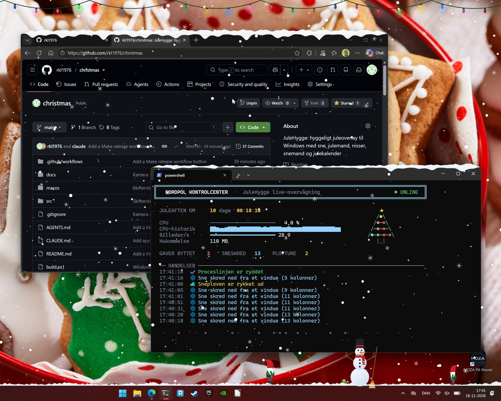
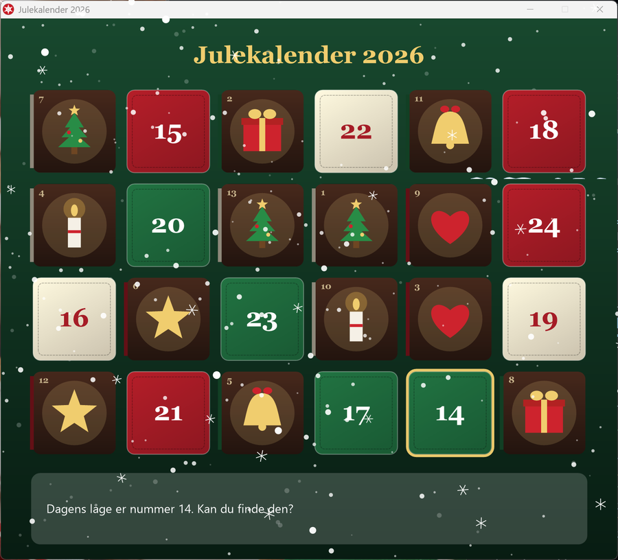

# JuleHygge 🎄

[Dansk](README.md) · [English](README.en.md) · [Svenska](README.sv.md) · [Deutsch](README.de.md) · [Nederlands](README.nl.md)

A small Christmas overlay for Windows, macOS and Linux: snow falls over your desktop and settles on the taskbar and on your windows, Santa flies past in his sleigh with reindeer (and Rudolph), little figures walk along the bottom of the screen and swap gifts, Christmas lights hang along the top, children build a snowman (and the snow plow runs it down), and there is an advent calendar with 24 doors.

| Snow on windows, walkers, snowman and lights | Advent calendar |
|---|---|
|  |  |

## What it does

- The overlay is see-through and you click straight through it, so it does not get in the way of your work.
- It works on **all screens**. Santa flies across screens that stand side by side.
- **The menu:** right-click the snowflake icon by the clock on Windows and Linux, or click it in the menu bar on macOS, for the settings and the advent calendar. Everything can be switched on and off there.
- **Advent calendar:** from 1 December you can open a new door every day. Behind the doors are jokes, cosy tips and Christmas facts, and some doors set off an effect: Santa, a blizzard, a party or a shower of stars.
- **Snowman:** three children build a snowman on the taskbar in about a quarter of an hour: they roll the balls, lift them onto each other and give it eyes, a carrot nose, buttons, arms, a smile, a scarf and a hat. When it is finished they cheer and have a snowball fight, and a few minutes later the snow plow comes by and runs it down. Then the children go somewhere else and start again. (That is on Windows. On macOS and Linux the snowman is still built over 12 days.)
- **Snow plow:** drives out and clears the snow when the pile gets high.
- **Sound** is off until you switch it on in the menu: sleigh bells and a tune for Santa, engine and horn for the snow plow.
- **Autumn theme:** the menu "Theme" swaps the snow for falling leaves, Santa for migrating geese and the snowman for a scarecrow.
- The animation pauses by itself while an app runs in full screen (games, films), and stops completely while the screen is locked or asleep.
- A released version keeps itself up to date.

## Your language, your figures

- **Language:** the menu is shown in your computer's language when there is a translation for it (Danish, English, Swedish, German, Dutch), and in English otherwise. You can choose another under *Language* in the menu.
- **Who walks on your screen** follows your language and country: nisser in the Nordic countries, Wichtel in Germany, Austria and Switzerland, kabouters in the Netherlands, päkapikud in Estonia and Christmas elves everywhere else. You can choose another under *Gnomes or elves* in the menu.
- Still in Danish only: the advent calendar and its doors, and the notifications.

## Get it

Download the newest version from the [releases page](https://github.com/rkl1976/christmas/releases/latest).

| System | File | How |
|---|---|---|
| Windows | `JuleHygge.exe` | Run it. There is nothing to install. |
| macOS | `JuleHygge-macOS.zip` | Unpack it and move JuleHygge to Applications. The app is not notarized by Apple, so macOS may ask you to allow it the first time. |
| Linux (Ubuntu, Linux Mint) | `JuleHygge-linux-x86_64.tar.gz` | Unpack it and run `./install.sh` (no root needed). |

Quit from the menu: *Quit*.

## More

Building the app, test aids and how the code is laid out are described in the [Danish README](README.md) (partly in English), in [macos/README.md](macos/README.md) (Danish) and in [linux/README.md](linux/README.md) (English). To add a language, see [assets/sprog/README.md](assets/sprog/README.md).

*This page was translated by a language model and has not been read by a native speaker.*
