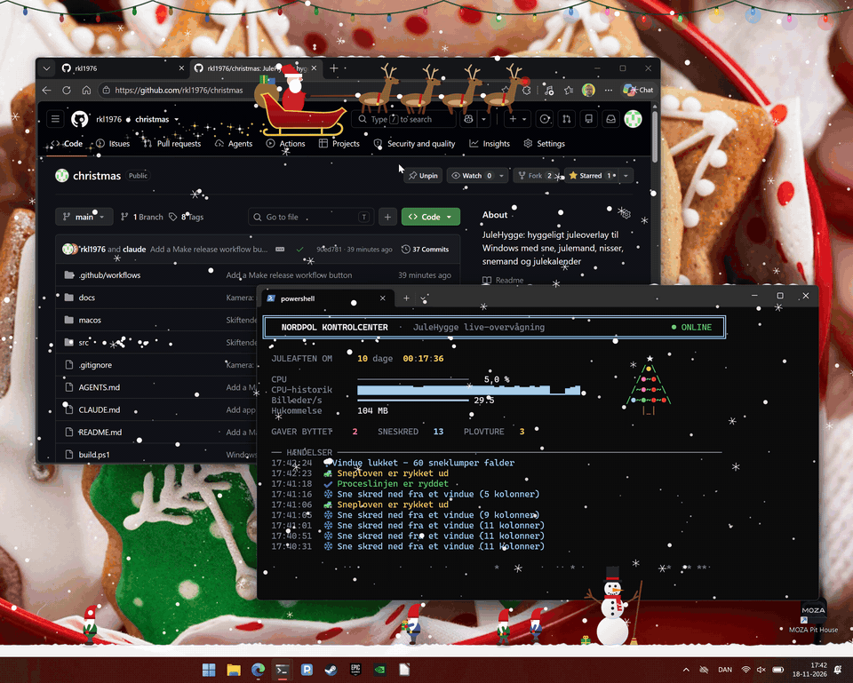
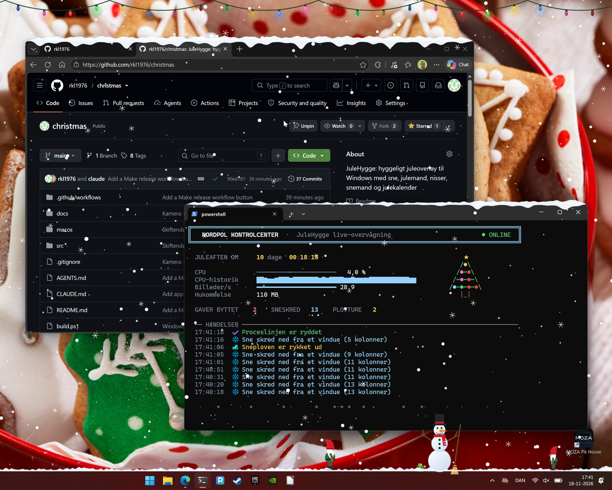
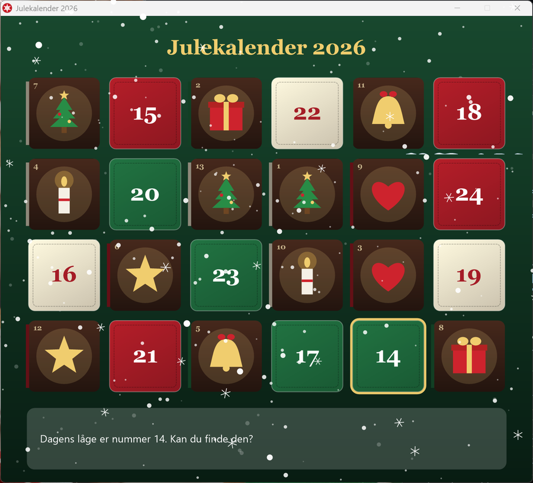

# JuleHygge 🎄

[Dansk](README.md) · [English](README.en.md) · [Svenska](README.sv.md) · [Deutsch](README.de.md) · [Nederlands](README.nl.md)

Et lille juleoverlay til Windows, macOS og Linux: snevejr, sne der lægger sig på proceslinjen, julemanden i kane med rensdyr (og Rudolf), nisser der går rundt på proceslinjen, julelys langs toppen af skærmen, børn der bygger en snemand (som sneploven kører ned), og en julekalender med 24 låger.



| Snow on windows, nisser, snowman and lights | Advent calendar |
|---|---|
|  |  |

*The terminal in the pictures runs [`tools/nordpol.ps1`](tools/nordpol.ps1), a small live dashboard that follows the app's debug log (gifts exchanged, snow sliding off windows, plow runs, CPU and frame rate).*

- Overlayet er gennemsigtigt, og man kan klikke igennem det, så det forstyrrer ikke arbejdet.
- Det virker på **alle skærme**. Julemanden flyver hen over de skærme, der står ved siden af hinanden.
- Højreklik på snefnug-ikonet ved uret for **indstillinger** og **julekalenderen**. Dobbeltklik på ikonet kalder julemanden frem.
- **Julekalender:** Fra 1. december kan du åbne en ny låge hver dag. Bag lågerne er der vittigheder, hyggetips og julefakta, og nogle låger sætter gang i en effekt: julemanden, snestorm, nissefest eller stjerneregn. Du får en besked ved uret, når dagens låge er klar.
- **Snemand:** Tre børn bygger en snemand på proceslinjen. De ruller sneboldene, løfter dem op på hinanden og giver den øjne, gulerodsnæse, knapper, arme, smil, halstørklæde og hue. Det tager omkring et kvarter. Når den er færdig, jubler de og holder sneboldkamp, og et par minutter senere kommer sneploven og kører den ned. Så går børnene et andet sted hen og begynder forfra.
- Animationen pauser automatisk, når et program kører i fuldskærm (spil, film).
- **Sprog:** Menuen vises på computerens sprog, når der er en oversættelse til det (dansk, engelsk, svensk, tysk, hollandsk), og ellers på engelsk. Du kan vælge et andet under *Sprog / Language* i menuen. Julekalenderen og beskederne er indtil videre kun på dansk. Et nyt sprog er en ny fil: se [assets/sprog/README.md](assets/sprog/README.md).
- **Nisser eller alfer:** Hvem der går på skærmen, følger sprog og land: nisser i Norden, Wichtel i Tyskland, Østrig og Schweiz, kabouters i Holland, päkapikud i Estland og julealfer i resten af verden. Du kan vælge andre under *Nisser eller alfer* i menuen.
- Indstillingerne gemmes i `%APPDATA%\JuleHygge\settings.ini`.

### Also on Windows (ported from the macOS version)
- **Organic variation:** snowfall drifts slowly between ~60% and ~140% of the chosen amount, and every 1½–3 minutes a nisse walks in or out (at most ±2 from the chosen count).
- **Across screens:** nisser walk over to a neighbouring screen about half the time, and the snow plow drives one continuous run across side-by-side screens.
- **Frame rate menu** (12/20/30/60 fps for the calm scene, default 20); Santa and the plow are boosted to 30 fps only while they move. Power-save caps the calm scene at 12 fps; snow still covers the whole screen.
- **Snow on windows** (menu "Sne på vinduerne", on by default): some flakes land on the top edge of other apps' windows, pile up, and hang down over the edge in soft lobes once deep. Snow is hidden behind windows in front, follows a moved window once it settles, and falls as clumps into the ground pile when the window is minimized or closed. Maximized and fullscreen windows carry no snow.
- **Snowstorm drifts:** the wind carries snow along the ground and window edges into drifts at the downwind end, flakes settle in long waves, and full piles keep soft bumps on top.
- **Nisser exchange gifts:** two nisser meeting each other stop; a gift is handed over, or swapped if both carry one.
- **Stops completely** while the PC is locked, suspended, the display is off or the screen saver runs. Santa's trip and the plow run end at once (as if they had arrived) and the sound stops.
- **Sound** (off by default, switched on separately in the menu): sleigh bells and one of three public-domain tunes for Santa — "Jingle Bells" (Pierpont 1857), "Deck the Halls" or "We Wish You a Merry Christmas" — played a little faster or slower with Santa's ±10% pace; engine, scraping and horn for the snow plow. Panned with the figure across the screens and synthesized in code (no sound files).
- **Restarts itself after a crash:** a small supervisor process runs the app and restarts it after 5 s (it gives up after 3 quick crashes). Quitting from the menu closes both, so two `JuleHygge.exe` processes are expected.
- **Updates itself:** a release build checks GitHub releases 1 minute after start and then every 6 hours. A newer `JuleHygge.exe` is downloaded next to the running one, checked (GitHub's SHA-256 digest, and its version must match the release tag), swapped in, and the app restarts into it. Menu: *Opdatér automatisk* (on by default) and *Søg efter opdatering nu*. Local builds are version 0.0.0 and never update. The exe must sit in a folder the user can write to.

## Linux
Se [linux/README.md](linux/README.md) (på engelsk): native udgave til Ubuntu og Linux Mint med snefnugget i panelet. Installér fra udgivelsens `JuleHygge-linux-x86_64.tar.gz` med `./install.sh`.

## macOS
Se [macos/README.md](macos/README.md) — native Swift-udgave i menulinjen med samme figurer og julekalender. Byg med `macos/build.sh`.

## Byg og kør (Windows)

```powershell
powershell -ExecutionPolicy Bypass -File .\build.ps1
.\JuleHygge.exe              # start
.\JuleHygge.exe --kalender   # start og åbn julekalenderen med det samme
```

Kræver ikke nogen installation. Den bruger den C#-compiler, der følger med Windows (.NET Framework 4.x).
Al grafik tegnes i koden, så der ikke er billedfiler.

**Test med en anden dato:** Sæt `$env:JULE_DATE = '2026-12-10'`, før du starter programmet. Så opfører kalenderen sig, som om det er den dag. Bemærk at åbnede låger bliver gemt i indstillingerne. `JULE_SNOWMAN_SPEED=30` lader børnene bygge snemanden 30 gange hurtigere.

**Test aids** (same names as on macOS):

| Flag / environment variable | Effect |
|---|---|
| `--kalender` | opens the advent calendar at start |
| `--julemand` | sends Santa right away |
| `--sneplov` / `--sneplov=N` | sends the snow plow after 3 / N seconds |
| `--effekt=N` | calendar effect: 1 Santa, 2 blizzard, 3 nisse party, 4 star shower, 5 everything |
| `--lyd-test=DIR` | writes the synthesized sounds as WAV files (plus `summary.txt`) and quits |
| `JULE_SETTINGS=path` | uses another settings file, so tests never change the real settings |
| `JULE_DATE=yyyy-MM-dd` | pretends it is another date |
| `JULE_DEBUG=1` | debug lines in `%TEMP%\julehygge-debug.log` |
| `JULE_FPS=N` | fixed frame rate (for measurements) |
| `JULE_DEEPSNOW=1` | starts with a full snow drift (for testing the snow plow) |
| `JULE_NISSE_SECONDS=N` | nisser arrive/leave every N seconds |
| `JULE_NO_SUPERVISOR=1` | runs without the restart supervisor (test flags also skip it) |
| `JULE_UPDATE_VERSION=x.y.z` | pretends to be this version when checking for updates |

**Releases:** `.github/workflows/windows-build.yml` builds the exe on every push and pull request, and for a published release builds it with the tag as version (`build.ps1 -Version 1.4.0`) and attaches it. To release, run **Make release** in the Actions tab (`.github/workflows/release.yml`, or `gh workflow run release.yml -f bump=patch`): it raises the version (patch, minor or major), builds both apps, attaches them and then publishes the release, with the merged PRs listed in the notes. Merges to `main` are never released by themselves.

## Kode

| Fil | Indhold |
|-----|---------|
| `src/Program.cs` | Opstart, testdato, små dataklasser |
| `src/Controller.cs` | Bakkeikon og menu, hovedløkke, julemanden, effekter, daglige beskeder |
| `src/Layer.cs` | Ét gennemsigtigt overlay-vindue pr. skærm: sne, nisser, julelys, snemand |
| `src/Calendar.cs` | Julekalender-vinduet og indholdet bag lågerne |
| `src/Settings.cs` | Indlæsning og gemning af indstillinger |
| `src/Sound.cs` | Sound synthesis (jingle, snow plow) and `waveOut` playback on its own thread |
| `src/PowerWatcher.cs` | Detects when the display turns off or on |
| `src/WindowSnow.cs` | Snow on other apps' window edges: window scan, piles, drapes, falling clumps |
| `src/Updater.cs` | Self-update from GitHub releases: check, download, verify, swap the exe |
| `src/SnowmanBuild.cs` | The snowman the children build: balls, lifts, dressing, snowball fight, waiting for the plow, a new place |
| `src/LayerSnowman.cs` | Draws the snowman, the children and their snowballs, and lets the plow run the snowman down |

## Ideer til næste version
- Sne der lægger sig på toppen af åbne vinduer
- JuleHygge Kamera (Teams background) on Windows — needs a virtual camera driver and person segmentation, so it is a separate project
