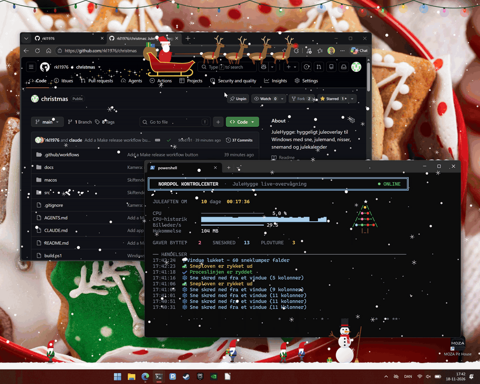
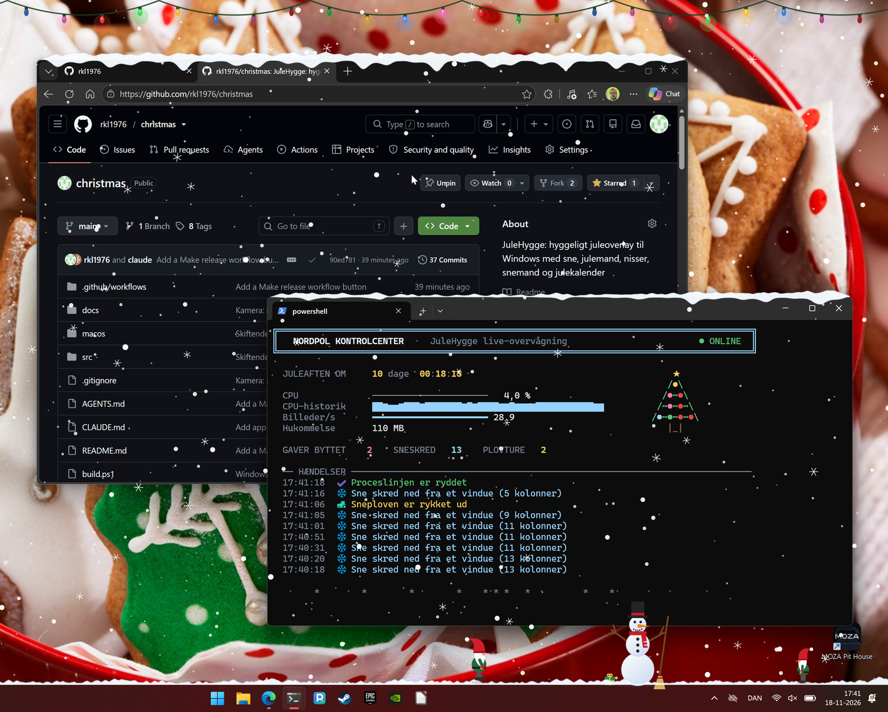
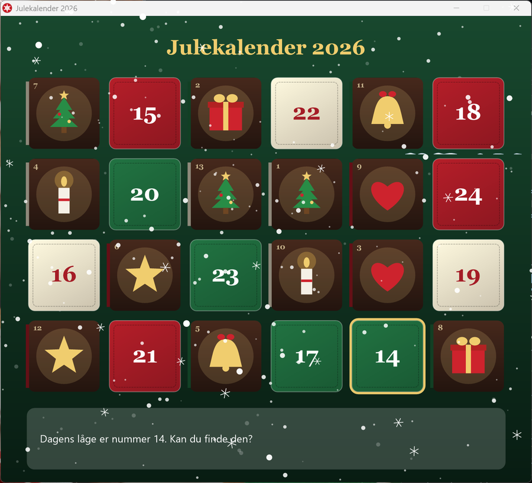

# JuleHygge 🎄

[Dansk](README.md) · [English](README.en.md) · [Svenska](README.sv.md) · [Deutsch](README.de.md) · [Nederlands](README.nl.md)

Een kleine kerstoverlay voor Windows, macOS en Linux: er valt sneeuw over je bureaublad die blijft liggen op de taakbalk en op je vensters, de Kerstman vliegt voorbij in zijn slee met rendieren (en Rudolf), kleine figuurtjes lopen onder aan het scherm en ruilen cadeautjes, bovenaan hangt kerstverlichting, kinderen bouwen een sneeuwpop (die de sneeuwschuiver omverrijdt), en er is een adventskalender met 24 deurtjes.

| Sneeuw op vensters, figuurtjes, sneeuwpop en lichtjes | Adventskalender |
|---|---|
|  |  |

## Wat het doet

- De overlay is doorzichtig en je klikt er gewoon doorheen, dus hij zit je werk niet in de weg.
- Het werkt op **alle schermen**. De Kerstman vliegt over schermen die naast elkaar staan.
- **Het menu:** klik met de rechtermuisknop op het sneeuwvlokje bij de klok in Windows en Linux, of klik erop in de menubalk op macOS, voor de instellingen en de adventskalender. Daar kun je alles aan- en uitzetten.
- **Adventskalender:** vanaf 1 december kun je elke dag een nieuw deurtje openen. Achter de deurtjes zitten grapjes, gezellige tips en kerstweetjes, en sommige deurtjes starten een effect: de Kerstman, een sneeuwstorm, een feestje of een sterrenregen.
- **Sneeuwpop:** drie kinderen bouwen in ongeveer een kwartier een sneeuwpop op de taakbalk: ze rollen de ballen, tillen ze op elkaar en geven hem ogen, een wortelneus, knopen, armen, een glimlach, een sjaal en een muts. Als hij klaar is, juichen ze en houden ze een sneeuwballengevecht, en een paar minuten later komt de sneeuwschuiver en rijdt hem omver. Dan gaan de kinderen ergens anders heen en beginnen opnieuw. (Zo is het op Windows en macOS. Op Linux wordt de sneeuwpop nog in 12 dagen gebouwd.)
- **Sneeuwschuiver:** rijdt uit en ruimt de sneeuw als de hoop hoog wordt.
- **Geluid** staat uit tot je het in het menu aanzet: belletjes en een deuntje voor de Kerstman, motor en claxon voor de sneeuwschuiver.
- **Herfstthema:** het menu "Thema" verruilt de sneeuw voor vallende bladeren, de Kerstman voor trekganzen en de sneeuwpop voor een vogelverschrikker.
- De animatie pauzeert vanzelf zolang een app in volledig scherm draait (games, films), en stopt helemaal als het scherm vergrendeld is of in de sluimerstand staat.
- Een uitgebrachte versie houdt zichzelf up-to-date.

## Jouw taal, jouw figuurtjes

- **Taal:** het menu verschijnt in de taal van je computer als daar een vertaling voor is (Deens, Engels, Zweeds, Duits, Nederlands), en anders in het Engels. Onder *Taal* in het menu kun je een andere kiezen.
- **Wie er over je scherm loopt** hangt af van je taal en land: nisser in de Noordse landen, Wichtel in Duitsland, Oostenrijk en Zwitserland, kabouters in Nederland, päkapikud in Estland en kerstelfen in de rest van de wereld. Onder *Kabouters of elfen* in het menu kun je andere kiezen.
- Voorlopig alleen in het Deens: de adventskalender met zijn deurtjes en de meldingen.

## Downloaden

Download de nieuwste versie van de [releasepagina](https://github.com/rkl1976/christmas/releases/latest).

| Systeem | Bestand | Hoe |
|---|---|---|
| Windows | `JuleHygge.exe` | Start het. Er hoeft niets geïnstalleerd te worden. |
| macOS | `JuleHygge-macOS.zip` | Pak het uit en zet JuleHygge in de map Apps. De app is niet door Apple genotariseerd, dus macOS kan de eerste keer om je toestemming vragen. |
| Linux (Ubuntu, Linux Mint) | `JuleHygge-linux-x86_64.tar.gz` | Pak het uit en voer `./install.sh` uit (geen root nodig). |

Afsluiten via het menu: *Afsluiten*.

## Meer

Hoe je de app bouwt, de testhulpmiddelen en de opbouw van de code staan in de [Deense README](README.md) (deels in het Engels), in [macos/README.md](macos/README.md) (Deens) en in [linux/README.md](linux/README.md) (Engels). Een taal toevoegen? Zie [assets/sprog/README.md](assets/sprog/README.md) (Engels).

*Deze pagina is vertaald door een taalmodel en niet gelezen door iemand met Nederlands als moedertaal.*
