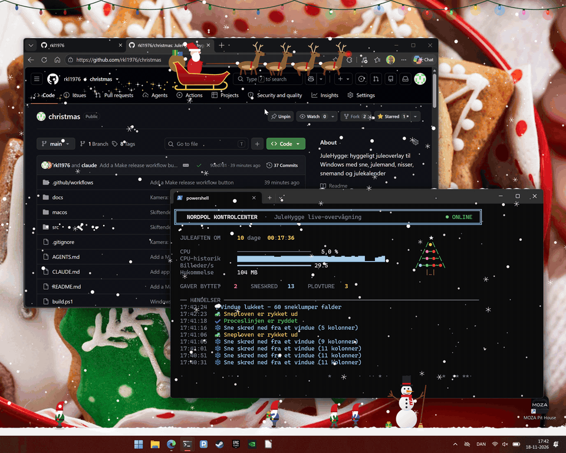
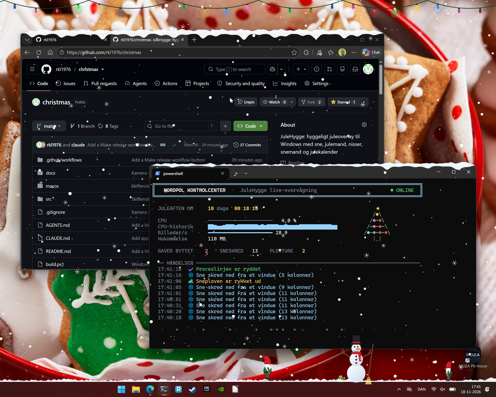
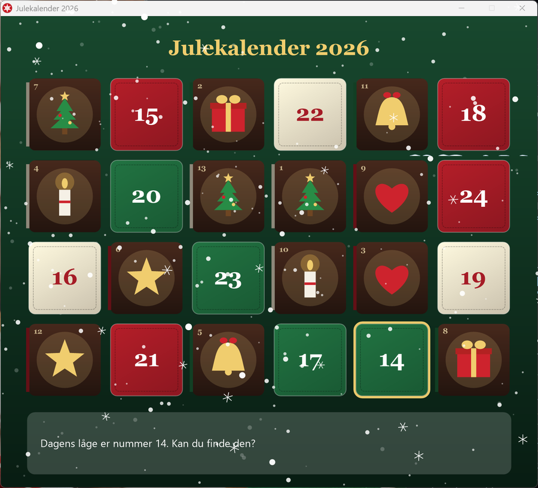

# JuleHygge 🎄

[Dansk](README.md) · [English](README.en.md) · [Svenska](README.sv.md) · [Deutsch](README.de.md) · [Nederlands](README.nl.md)

Ett litet julöverlägg för Windows, macOS och Linux: snön faller över skrivbordet och lägger sig på aktivitetsfältet och på dina fönster, jultomten flyger förbi i sin släde med renar (och Rudolf), små figurer går längs skärmens nederkant och byter klappar, julbelysning hänger längs överkanten, barn bygger en snögubbe (som snöplogen kör över), och det finns en julkalender med 24 luckor.

| Snö på fönster, figurer, snögubbe och belysning | Julkalender |
|---|---|
|  |  |

## Vad det gör

- Överlägget är genomskinligt och du klickar rakt igenom det, så det stör inte ditt arbete.
- Det fungerar på **alla skärmar**. Jultomten flyger över skärmar som står bredvid varandra.
- **Menyn:** högerklicka på snöflingan vid klockan i Windows och Linux, eller klicka på den i menyraden på macOS, för inställningarna och julkalendern. Där kan allt slås på och av.
- **Julkalender:** från den 1 december kan du öppna en ny lucka varje dag. Bakom luckorna finns skämt, mystips och julfakta, och vissa luckor sätter igång en effekt: jultomten, snöstorm, fest eller stjärnregn.
- **Snögubbe:** tre barn bygger en snögubbe på aktivitetsfältet på ungefär en kvart: de rullar snöbollarna, lyfter dem på varandra och ger den ögon, morotsnäsa, knappar, armar, ett leende, halsduk och mössa. När den är klar jublar de och har snöbollskrig, och några minuter senare kommer snöplogen och kör över den. Sedan går barnen till ett annat ställe och börjar om.
- **Snöplog:** kör ut och röjer snön när drivan blir hög.
- **Ljudet** är avstängt tills du slår på det i menyn: bjällror och en melodi för jultomten, motor och tuta för snöplogen.
- **Hösttema:** menyn "Tema" byter snön mot fallande löv, jultomten mot flyttgäss och snögubben mot en fågelskrämma.
- **Tema för De dödas dag:** i samma meny finns "De dødes dag" (Día de los Muertos): kronblad från tagetes faller, skelett i sombrero går längst ner, monarkfjärilar flyger förbi, pappersflaggor hänger längst upp och ett altare byggs ett steg för varje timme programmet kör.
- **Halloweentema:** i samma meny finns "Halloween": löv faller, spöken och utklädda barn går längst ner, en häxa flyger förbi på sin kvast med fladdermöss efter sig, en slinga med små pumpalyktor hänger längst upp, svarta katter sitter på fönstren och tre pumpalyktor skärs ut, ett steg för varje timme programmet kör.
- Animationen pausar av sig själv när en app körs i helskärm (spel, film), och stannar helt när skärmen är låst eller i vila.
- En utgiven version håller sig själv uppdaterad.

## Ditt språk, dina figurer

- **Språk:** menyn visas på datorns språk när det finns en översättning (danska, engelska, svenska, tyska, nederländska, italienska, spanska (även mexikansk), franska, portugisiska (även brasiliansk)), annars på engelska. Du kan välja ett annat under *Språk* i menyn.
- **Vilka som går på din skärm** följer språk och land: tomtar (nisser) i Norden, Wichtel i Tyskland, Österrike och Schweiz, kabouters i Nederländerna, päkapikud i Estland och julälvor i resten av världen. Du kan välja andra under *Tomtar eller älvor* i menyn.
- Finns än så länge bara på danska: julkalendern och dess luckor, samt aviseringarna.

## Hämta det

Ladda ned den senaste versionen från [utgåvesidan](https://github.com/rkl1976/christmas/releases/latest).

| System | Fil | Så här |
|---|---|---|
| Windows | `JuleHygge.exe` | Kör den. Inget behöver installeras. |
| macOS | `JuleHygge-macOS.zip` | Packa upp och flytta JuleHygge till Program. Appen är inte notariserad av Apple, så macOS kan be dig godkänna den första gången. |
| Linux (Ubuntu, Linux Mint) | `JuleHygge-linux-x86_64.tar.gz` | Packa upp och kör `./install.sh` (root behövs inte). |

Avsluta från menyn: *Avsluta*.

## Mer

Hur appen byggs, testhjälpmedel och hur koden är upplagd beskrivs i den [danska README-filen](README.md) (delvis på engelska), i [macos/README.md](macos/README.md) (danska) och i [linux/README.md](linux/README.md) (engelska). Vill du lägga till ett språk, se [assets/sprog/README.md](assets/sprog/README.md) (engelska).

*Den här sidan är översatt av en språkmodell och har inte lästs av någon med svenska som modersmål.*
